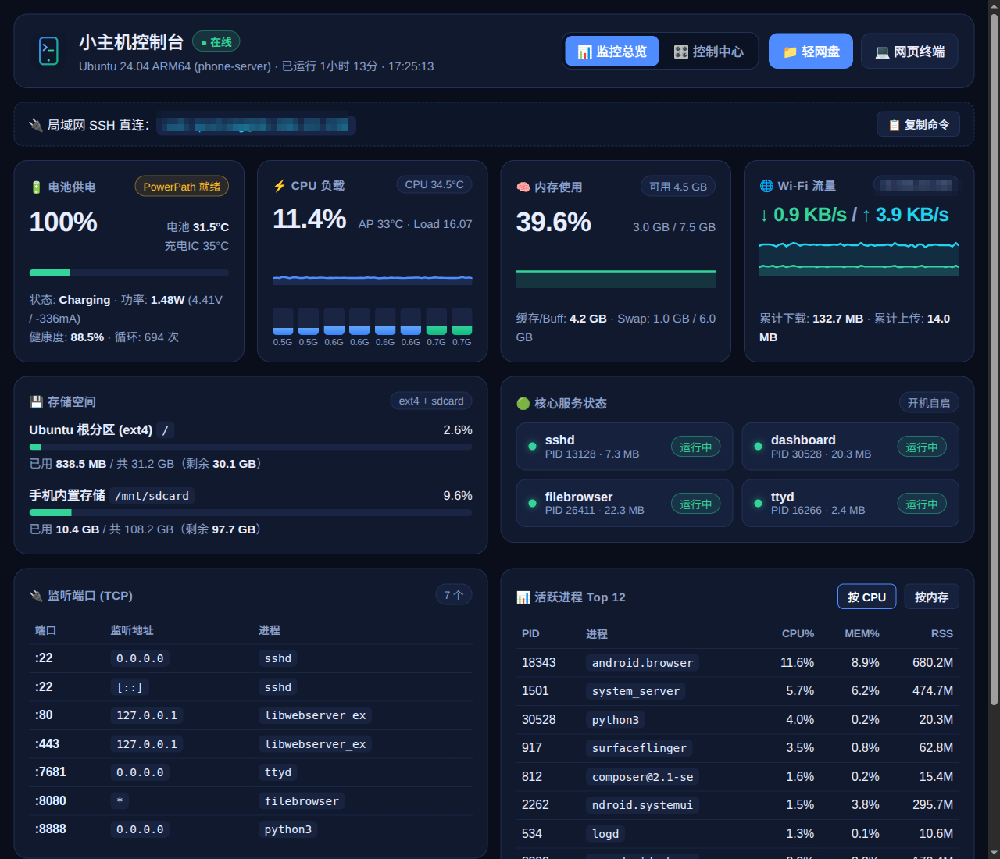
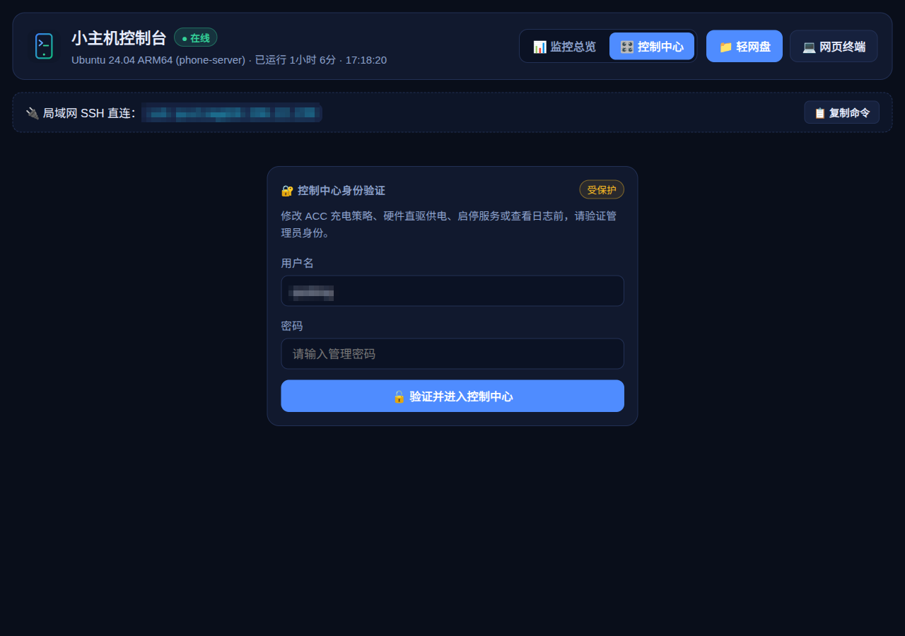
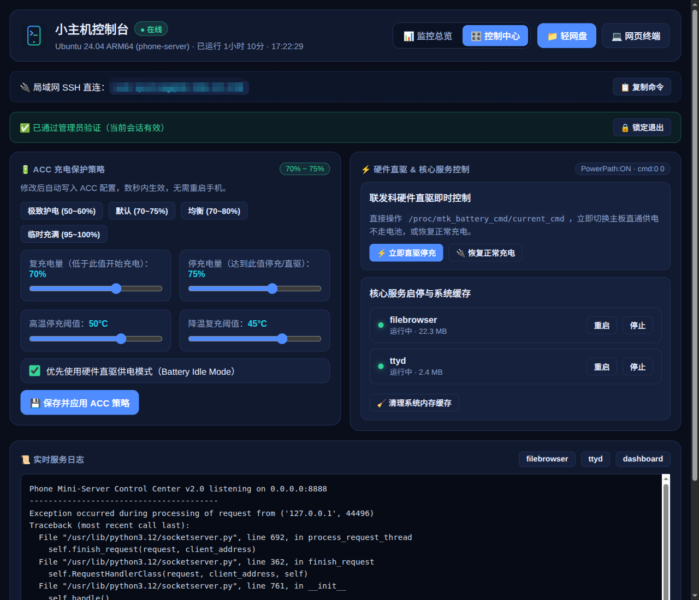

# Android Root 手机改造 ARM64 Linux 小主机

> 把一台已 Root 的 **Redmi Note 11 SE（天玑 700 / 8GB RAM / 128GB / MIUI 14 / Android 13）** 改造成 24 小时低功耗原生 **Ubuntu 24.04.5 LTS ARM64** 小主机，完整保留原安卓系统，附带硬件级直驱充电保护（ACC）、前后端分离的 Web 监控与控制中心、FileBrowser 轻网盘、ttyd 网页终端与本机同款 Oh My Zsh 环境。

---

## 界面预览

### 1. 监控总览（只读实时看板）
实时展示电池与联发科硬件直驱状态、8 核主频柱状图、4 路温度传感器、CPU/内存/Wi-Fi 滚动曲线、存储空间、核心服务、TCP 监听端口与 Top 12 进程。



### 2. 控制中心身份门禁与控制面板
点击顶部「🎛️ 控制中心」需先通过管理员身份验证；解锁后可实时调节 ACC 复充/停充阈值与温控、一键切换联发科硬件直驱供电、启停/重启服务、清理内存缓存与查看实时日志。

| 身份验证门禁 | 解锁后的控制中心 |
| :---: | :---: |
|  |  |

---

## 目录结构

```text
android-mini-server/
├── Makefile                        # 一键部署 / 查看状态 / SSH / USB 转发 / 镜像备份
├── README.md
├── android/                        # Android 宿主侧（Magisk / chroot 编排）
│   ├── linux-ctl.sh                # 挂载 ext4 镜像、绑定存储与 ACC 目录、启停服务
│   └── service.d/
│       └── 99-ubuntu-server.sh     # Magisk 开机自启钩子
├── ubuntu/                         # Ubuntu 容器侧配置
│   ├── rc.local                    # 开机拉起 Web 套件
│   └── zshrc.template              # Oh My Zsh (ys 主题 + 常用插件) 模板
├── dashboard/                      # 前后端分离的轻量控制台（零第三方依赖）
│   ├── server.py                   # HTTP 路由与 Basic Auth 鉴权入口
│   ├── metrics.py                  # CPU/8核主频/4路温度/电池/网速/端口/进程采集
│   ├── services.py                 # 服务启停、ACC 配置读写、硬件直驱与日志读取
│   └── static/
│       ├── index.html              # 双页结构：监控总览（只读）+ 控制中心（鉴权门禁）
│       ├── style.css               # 响应式深色主题样式
│       ├── app.js                  # 前端交互、SVG 实时曲线与鉴权逻辑
│       ├── manifest.json           # PWA 独立应用清单
│       ├── icon.svg / icon.png     # 矢量与 192×192 桌面应用图标
└── docs/                           # 折腾过程、知识点与速查手册
    ├── 01-root-and-modules.md
    ├── 02-ubuntu-chroot-setup.md
    ├── 03-web-and-zsh-setup.md
    └── 04-cheatsheet.md
```

---

## 常用开发与运维命令（`Makefile`）

```bash
make deploy            # 一键同步 android/ ubuntu/ dashboard/ 到手机并重启控制台
make deploy-dashboard  # 修改前端或后端代码后，2 秒热部署到手机 :8888
make status            # 查看手机小主机挂载、4 个服务状态、IP 与电量
make ssh               # 以日常用户免密登录小主机
make forward           # 通过 USB 转发 2222 / 8888 / 8080 / 7681 端口
make backup            # 停服并拉出 ubuntu.img 完整镜像备份
```

---

## 快速访问入口

- **监控总览（只读）**：`http://<手机IP>:8888`（手机本机：`http://127.0.0.1:8888`）
- **控制中心（需身份验证）**：点击页面顶部 **「🎛️ 控制中心」**，支持调节 ACC 复充/停充阈值与温控、联发科硬件直驱即时开关、服务启停/重启、清理内存缓存与查看服务日志
- **FileBrowser 轻网盘**：`http://<手机IP>:8080`
- **ttyd 网页终端**：`http://<手机IP>:7681`
- **SSH 登录**：`ssh phone`（或换电脑后 `ssh <your-user>@<手机IP>`）

> 所有认证凭据仅存放在手机本地 `/etc/phone-server-auth`（权限 `600`），不写入 Git 仓库。

---

## 文档导航

1. [01 - Root 生态、Magisk 模块与 ACC 充电保护](docs/01-root-and-modules.md)
2. [02 - 原生 Ubuntu 24.04 chroot 搭建全流程与踩坑实录](docs/02-ubuntu-chroot-setup.md)
3. [03 - 国内源、Oh My Zsh 与轻量 Web 套件部署](docs/03-web-and-zsh-setup.md)
4. [04 - 日常高频指令速查手册（SSH / ADB / ACC / 排错 / 卸载）](docs/04-cheatsheet.md)
